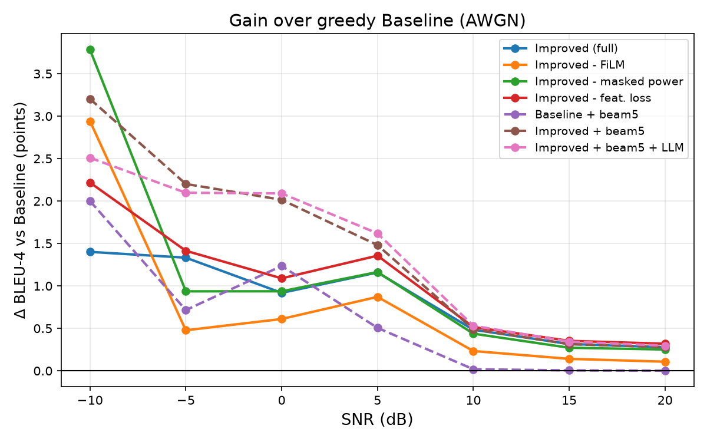
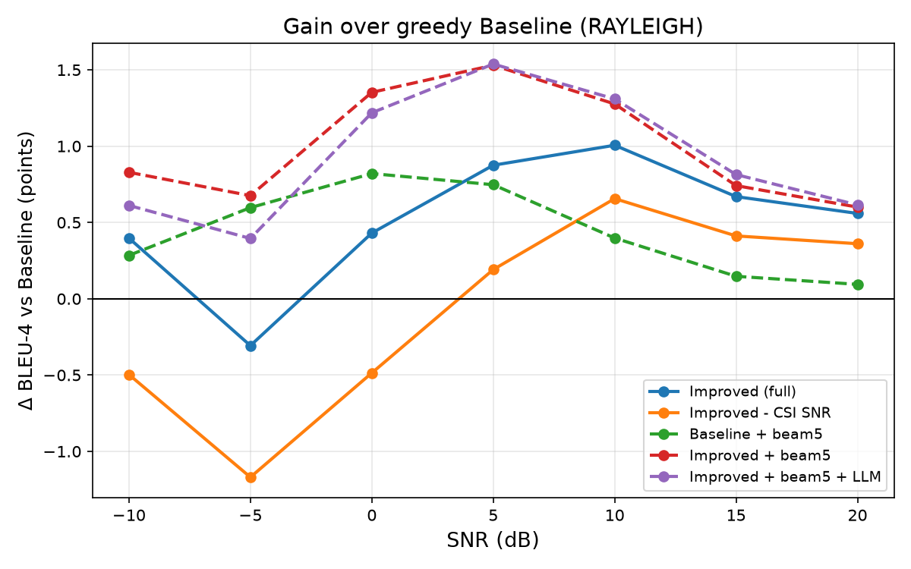

# v2 Experiment Results

## Setup

- 8 models × 80 epochs on a Colab GPU (≈56–65 s/epoch, ≈10 h of training)
  using `notebooks/train_v2_colab.ipynb`; Europarl data identical to v1
  (SHA-256 checked).
- Test: 10,000 sentences per SNR point, 7 points from −10 to 20 dB, same
  channel noise for every model at a given SNR. BLEU-4 reported with a
  95 % bootstrap CI (half-widths ≈ ±0.8 points at −10…0 dB, ±0.2 at 5 dB,
  ±0.1 at 10 dB on AWGN).
- Same channel uses (32 × 16 real symbols) and transmit energy per sentence
  for all models.
- Raw numbers: `checkpoints/*/eval_*.json`; full tables: [`summary.md`](summary.md);
  plots in this folder (regenerate with
  `python ablation.py --results_dir checkpoints --out_dir results_v2`).

Δ below = difference in **percentage points** to the greedy Baseline.

## AWGN

| BLEU-4 (greedy) | −10 dB | −5 dB | 0 dB | 5 dB | 10 dB |
|---|---|---|---|---|---|
| Baseline | 0.429 | 0.736 | 0.838 | 0.963 | 0.991 |
| Improved | 0.443 | 0.749 | 0.848 | 0.975 | 0.996 |
| **Improved + beam 5** | **0.461** | **0.758** | **0.859** | **0.978** | **0.996** |

| Δ vs Baseline (points) | −10 | −5 | 0 | 5 | 10 |
|---|---|---|---|---|---|
| Improved, BLEU-4 | +1.40 | +1.33 | +0.92 | +1.16 | +0.48 |
| Improved, Word Acc | +3.26 | +3.46 | +3.05 | +2.76 | +0.66 |
| Baseline + beam, BLEU-4 | +2.00 | +0.72 | +1.24 | +0.51 | +0.02 |
| Improved + beam, BLEU-4 | +3.20 | +2.20 | +2.01 | +1.48 | +0.49 |

### Ablations (AWGN, greedy, Δ BLEU-4 vs the full Improved model)

| Removed component | −10 | −5 | 0 | 5 | 10 |
|---|---|---|---|---|---|
| SNR-conditioned FiLM | +1.54 | −0.86 | −0.31 | −0.29 | −0.25 |
| Length-aware (masked) power | +2.38 | −0.40 | +0.02 | +0.01 | −0.05 |
| Feature-denoising loss | +0.82 | +0.08 | +0.17 | +0.20 | +0.03 |

## Rayleigh fading

| BLEU-4 (greedy) | −10 dB | −5 dB | 0 dB | 5 dB | 10 dB |
|---|---|---|---|---|---|
| Baseline | 0.345 | 0.572 | 0.746 | 0.870 | 0.941 |
| Improved | 0.349 | 0.569 | 0.750 | 0.878 | 0.951 |
| **Improved + beam 5** | **0.353** | **0.579** | **0.759** | **0.885** | **0.954** |

| Δ vs Baseline (points) | −10 | −5 | 0 | 5 | 10 |
|---|---|---|---|---|---|
| Improved, BLEU-4 | +0.40 | −0.31 | +0.43 | +0.88 | +1.01 |
| Improved, Word Acc | +0.82 | +0.61 | +1.62 | +2.28 | +1.88 |
| Improved without CSI-aware SNR, BLEU-4 | −0.50 | −1.17 | −0.49 | +0.19 | +0.66 |
| Improved + beam, BLEU-4 | +0.83 | +0.68 | +1.35 | +1.53 | +1.28 |

Removing the CSI-aware receiver costs 0.35–0.92 BLEU-4 points at **every**
SNR and drops the model below the Baseline at −10…0 dB.

## Decoder–BERT fusion refinement

Tuned on the validation split: λ = 0.25, τ = 0.7 for both channels (the
validation gain over no refinement was only +0.07 / +0.04 BLEU-4 points).
On the test set (beam 5, Δ BLEU-4 after − before refinement; fraction of
sentences changed in brackets):

| | −10 | −5 | 0 | 5 | 10 |
|---|---|---|---|---|---|
| AWGN | −0.69 (26 %) | −0.10 (14 %) | +0.08 (12 %) | +0.14 (5 %) | +0.04 (1 %) |
| Rayleigh | −0.22 (28 %) | −0.28 (20 %) | −0.13 (14 %) | +0.01 (9 %) | +0.03 (5 %) |

## Conclusions

1. **The improved transceiver beats DeepSC on both channels.** On AWGN it
   gains +0.5–1.4 BLEU-4 and +2.8–3.5 word-accuracy points up to 5 dB; on
   Rayleigh +0.4–1.0 BLEU-4 at 0–10 dB. With beam search the best system
   gains +2.0–3.2 BLEU-4 points at −10…0 dB on AWGN.
2. **What actually helps:** SNR-adaptive attention (shared by all Improved
   variants), the CSI-aware receiver under fading (the clearest ablation
   result), FiLM at −5…10 dB, and beam search.
3. **What does not help:** length-aware power normalisation and the
   feature-denoising loss show no measurable benefit — removing either one
   gives equal or slightly better results. The BERT fusion refiner is
   roughly neutral (±0.15 points at ≥ 0 dB) and slightly harmful at −10 dB;
   unlike v1 it no longer degrades results across the board.
4. **v1 → v2 (AWGN, same data):** the Baseline is unchanged (BLEU-4 at
   0 dB 0.837 → 0.838) while the best system improves from 0.849 to 0.859.
   Rayleigh numbers are not comparable with v1 because v1's channel had
   E[|h|²] = 2.

## Caveats

- Each model was trained once (single seed). At −10 dB the spread between
  Improved variants (0.443–0.467) exceeds the bootstrap CI, so part of the
  low-SNR differences reflects training variance; conclusions at −10 dB
  should be treated as tentative.
- The CIs are per model; since all models share sentences and noise, a
  paired test would be tighter.
- Word accuracy is position-wise, so it under-rates beam search at low SNR
  when beam outputs shift word positions; use BLEU for that comparison.
- BERTScore failed for a few −10 dB Rayleigh runs (shown as "–" in
  `summary.md`); BLEU and Word Acc are complete.
- Model weights and training histories are kept in Google Drive, not in
  the repository.

**Next steps:** retrain the Improved model without masked power and
feature loss (the simplest variant that matched or beat the full model),
and repeat the key comparisons with 3 seeds and paired significance tests.
